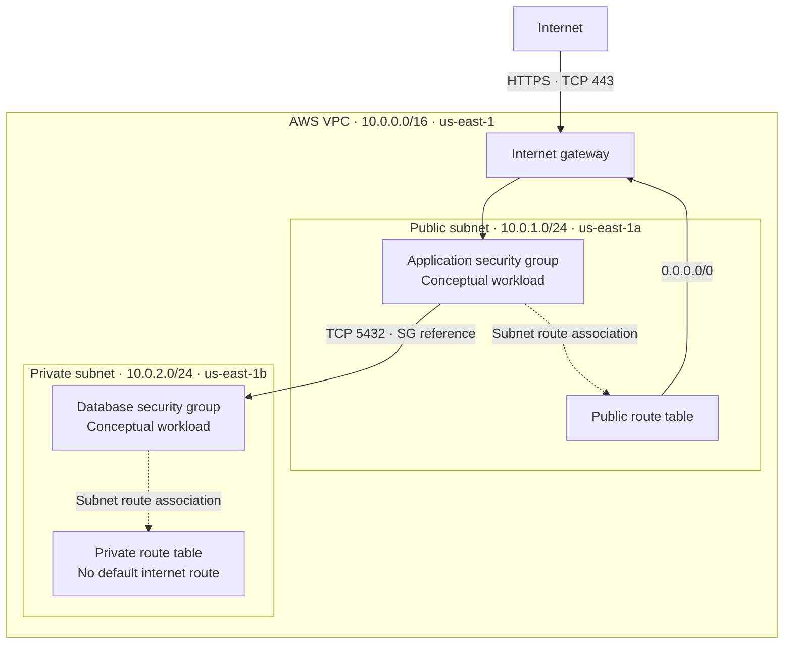

# AWS VPC Networking with Terraform

[](https://github.com/JamieChristian22/aws-vpc-terraform-lab/actions/workflows/terraform-validate.yml)

**Recruiter quick start:** [Infrastructure source](main.tf) · [Hands-on training log](docs/training/2026-11-23-cloud-platform-engineering.md) · [Validation workflow](.github/workflows/terraform-validate.yml)

A hands-on Infrastructure as Code (IaC) project demonstrating AWS networking, subnet isolation, route table management, and security group configuration using Terraform.

This project models a foundational two-tier cloud network designed for a public-facing application and a private PostgreSQL database.

**Project status:** Terraform configuration completed and locally validated. AWS resources have not been deployed.

## Project Objectives

- Define AWS networking infrastructure using Terraform.
- Separate public-facing and private workloads.
- Configure explicit subnet routing.
- Apply least-privilege network access controls.
- Use resource references instead of hardcoded AWS resource IDs.
- Validate infrastructure code without deploying resources.
- Document technical decisions and architectural limitations.

## Technologies

- Amazon Web Services (AWS)
- Terraform
- HashiCorp AWS Provider
- Amazon VPC
- AWS Subnets
- Internet Gateway
- Route Tables
- AWS Security Groups
- Git and GitHub
- Visual Studio Code

## Network Architecture

The configuration defines a VPC in the `us-east-1` AWS Region.

| Component | Configuration |
|---|---|
| AWS Region | us-east-1 |
| VPC CIDR | 10.0.0.0/16 |
| Public Subnet | 10.0.1.0/24 |
| Public Availability Zone | us-east-1a |
| Private Subnet | 10.0.2.0/24 |
| Private Availability Zone | us-east-1b |
| Public Internet Access | Internet Gateway |
| Private Internet Access | No default internet route |
| Application Protocol | HTTPS / TCP 443 |
| Database Protocol | PostgreSQL / TCP 5432 |

### Network and trust boundaries



This diagram depicts intended logical reachability and subnet associations, not a deployed network. Security groups attach to workload network interfaces; they are not themselves servers or routing devices. No EC2 or RDS instance is provisioned.

### Architecture Overview

```text
AWS Region: us-east-1
|
+-- VPC: 10.0.0.0/16
    |
    +-- Internet Gateway
    |
    +-- Public Subnet: 10.0.1.0/24
    |   Availability Zone: us-east-1a
    |   |
    |   +-- Public Route Table
    |   |   +-- 10.0.0.0/16 -> local
    |   |   +-- 0.0.0.0/0 -> Internet Gateway
    |   |
    |   +-- Application Security Group
    |       +-- Inbound HTTPS: TCP 443
    |       +-- Outbound HTTPS: TCP 443
    |       +-- Outbound PostgreSQL: TCP 5432
    |
    +-- Private Subnet: 10.0.2.0/24
        Availability Zone: us-east-1b
        |
        +-- Private Route Table
        |   +-- 10.0.0.0/16 -> local
        |   +-- No internet default route
        |
        +-- Database Security Group
            +-- Inbound PostgreSQL: TCP 5432
                Source: Application Security Group
```

The application and database are conceptual workloads. This project defines their network security groups but does not provision application servers or a database instance.

## Infrastructure Components

### 1. Virtual Private Cloud

Creates a logically isolated AWS network using the CIDR block `10.0.0.0/16`.

### 2. Public Subnet

Defines a subnet using `10.0.1.0/24` in `us-east-1a`.

The subnet is configured to automatically assign public IPv4 addresses to eligible launched network interfaces.

Its associated route table provides a default route to the Internet Gateway.

### 3. Private Subnet

Defines a subnet using `10.0.2.0/24` in `us-east-1b`.

Automatic public IPv4 assignment is disabled.

The subnet uses a dedicated route table without a default route to the internet.

### 4. Internet Gateway

Defines an Internet Gateway attached to the VPC.

The public route table references this gateway for IPv4 traffic destined outside the VPC.

### 5. Route Tables and Associations

The public route table includes:

- VPC local routing
- Default IPv4 route to the Internet Gateway

The private route table includes:

- VPC local routing
- No default internet route

Explicit subnet associations determine which route table each subnet uses.

### 6. Application Security Group

Defines network access controls for a conceptual public-facing application.

Configured rules:

- Inbound TCP 443 from any IPv4 address
- Outbound TCP 443 to any IPv4 address
- Outbound TCP 5432 to the database security group

### 7. Database Security Group

Defines a dedicated security group for a conceptual PostgreSQL database.

The configured inbound rule permits TCP port 5432 from resources associated with the application security group.

It does not define an internet-wide PostgreSQL ingress rule.

## Security Design

This project demonstrates several foundational cloud security practices.

**Network segmentation:** Public and private subnets are configured separately.

**Explicit routing:** Subnets are associated with dedicated route tables.

**Restricted database ingress:** PostgreSQL access is limited by security group reference rather than an unrestricted IPv4 CIDR range.

**Application-to-database permissions:** Application egress and database ingress rules support the intended PostgreSQL connection.

**Infrastructure as Code:** Networking resources and access rules are defined declaratively.

**Sensitive file exclusions:** A `.gitignore` file excludes local Terraform state, provider downloads, variable files, and other potentially sensitive artifacts.

Security groups are stateful. Response traffic for an allowed connection is automatically permitted.

The project does not claim to implement complete production security. A future deployment would require additional controls and testing.

## Terraform Validation

Terraform was initialized locally, and the configuration was checked using:

```bash
terraform fmt
terraform validate
```

`terraform fmt` standardizes formatting.

`terraform validate` checks configuration syntax, supported arguments, and internal references.

Validation does not prove that AWS resources can be deployed successfully or that the resulting infrastructure would satisfy every security requirement.

**No `terraform apply` was executed.**

## Continuous integration

A validation-only [GitHub Actions workflow](.github/workflows/terraform-validate.yml) checks Terraform formatting, initializes the pinned provider without a backend, and validates the configuration on relevant pushes, pull requests, and manual runs. It uses read-only repository permissions and does not need AWS credentials.

Check the [Actions page](https://github.com/JamieChristian22/aws-vpc-terraform-lab/actions/workflows/terraform-validate.yml) for actual run results; adding the workflow alone does not prove a successful run or successful AWS deployment.

## Project Structure

```text
aws-vpc-terraform-lab/
|
+-- main.tf
+-- README.md
+-- .gitignore
+-- .terraform.lock.hcl
+-- .github/workflows/terraform-validate.yml
+-- docs/training/2026-11-23-cloud-platform-engineering.md
```

Terraform may also create a local `.terraform/` directory after initialization. That directory is excluded from Git.

## How to Validate Locally

### Prerequisites

- Terraform CLI
- An editor such as Visual Studio Code

### Commands

Check the Terraform version:

```bash
terraform version
```

Initialize the working directory and download required providers:

```bash
terraform init -backend=false
```

Check formatting:

```bash
terraform fmt -check
```

Validate the configuration:

```bash
terraform validate
```

These commands do not create AWS infrastructure.

Do not execute `terraform apply` unless you intentionally decide to deploy the infrastructure after reviewing credentials, permissions, cost implications, and security controls.

## Architectural Limitations

This is a learning and portfolio project, not a deployed production environment.

Current limitations include:

- Only one public subnet and one private subnet
- No deployed EC2 application instances
- No deployed RDS PostgreSQL database
- No NAT Gateway or private outbound internet path
- No Application Load Balancer
- No deployed monitoring or logging infrastructure
- No demonstrated high-availability or disaster-recovery configuration
- No live AWS connectivity or security verification

The security group definitions also require review of default outbound behavior before production use.

## Potential Future Improvements

1. Expand to a redundant multi-Availability-Zone subnet layout.
2. Introduce an Application Load Balancer.
3. Deploy private application workloads.
4. Add an Amazon RDS PostgreSQL database.
5. Introduce VPC endpoints where appropriate.
6. Add VPC Flow Logs and monitoring.
7. Review and maintain the Terraform CI checks; confirm successful runs.
8. Add automated infrastructure security scanning.
9. Implement cost estimates and deployment safeguards.
10. Test the network in an authorized AWS environment.

Future improvements would be evaluated separately before any deployment.

## Skills Demonstrated

- Infrastructure as Code
- AWS VPC networking
- IPv4 CIDR planning
- Public and private subnet design
- Internet Gateway configuration
- Route table management
- Security group ingress and egress rules
- Resource dependency references
- Least-privilege network design
- Terraform formatting and validation
- Technical documentation

## Project Summary

This project demonstrates how Terraform can be used to define a foundational AWS network with separate public and private subnets, explicit routing, and application-to-database security group permissions.

The configuration was developed as a hands-on cloud engineering exercise and validated locally without deploying AWS resources.

## Hands-on Engineering Training

- [November 23, 2026 — Cloud / Platform Engineering Lab](docs/training/2026-11-23-cloud-platform-engineering.md): Terraform inspection, Linux permissions, Git, Docker troubleshooting, local Kubernetes deployment and cleanup, and GitHub Actions validation concepts.

The Kubernetes workload was deployed locally and removed after verification. AWS infrastructure remains undeployed; a validation-only CI workflow has since been added; review the Actions page for execution status.
